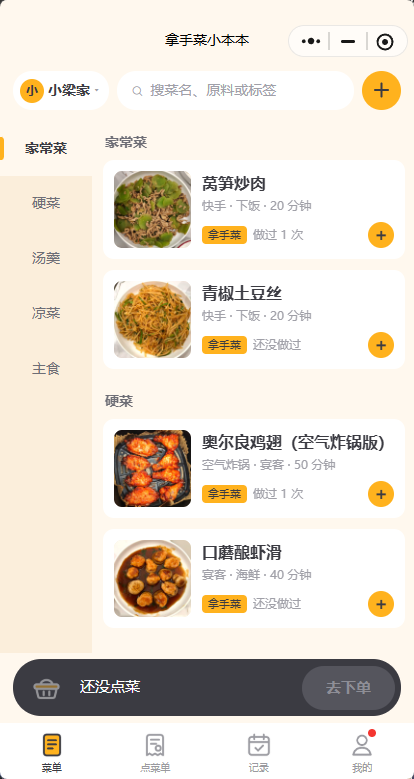
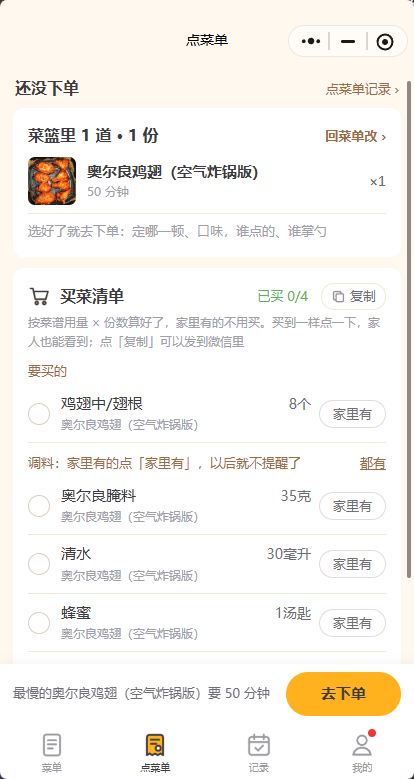
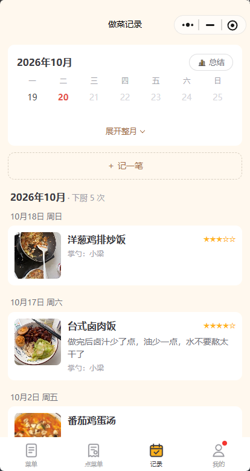
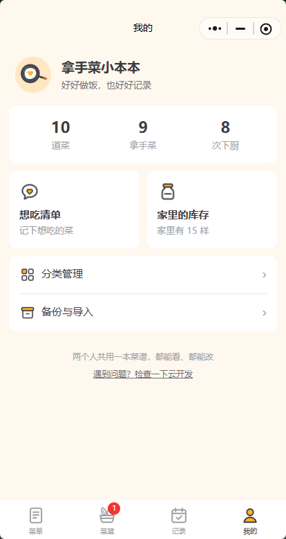

# 拿手菜小本本

> 好好做饭，也好好记录。

一家人一起记菜谱的微信小程序。在菜单里挑菜、下单，跟点外卖差不多，点菜单上的菜会自动合成买菜清单。做菜时按步骤看，带计时。做完打卡，日历上能看到哪天做了什么。

每个人有一本只有自己能看的「我的小本本」，也可以建家庭本本，家人用家庭码申请加入，本里的人都能看、都能改。代码是原生小程序（JavaScript）加微信云开发，不需要自己的服务器，用免费的云开发环境和体验版就行，不用花钱（免费环境的期限见[费用](#费用)）。

| 菜单 | 点菜单和买菜清单 | 做菜记录 | 我的 |
| :---: | :---: | :---: | :---: |
|  |  |  |  |

## 功能

### 点菜和下单

在菜单里点 + 把菜放进菜篮，点底部的菜篮可以查看、加减、清空，再点「去下单」。确认点菜单时选哪天、哪一顿，写口味备注、谁点的、谁掌勺，确认后生成一张带编号的点菜单。这一步只能看点了哪些菜，要改得回到菜单。

下单后还能加菜，也能点「改一改」修改哪一顿、口味和谁掌勺，撤单也在这里。编号只算开过饭的单，撤单不占号，下一单还用这个号。「点菜单记录」里有正在进行的那一单和开过饭的每一单，可以再来一单，也可以分享那顿饭。点菜单能发成小程序卡片给家人，也能存成一张小票样子的图片。

在菜谱详情页点「开始做」，也是先去确认点菜单，下好单直接开始做这一道。

### 买菜清单

下了单，「点菜单」页会列出买菜清单，原料按份数合并，并且对比家里的库存，家里有的不再提醒。买到一样勾一样。清单可以一键复制发到微信。

### 做菜

做菜时一步一屏，大字显示，屏幕不会灭，计时到点会震动、响提示音。

买完菜可以把点菜单上的几道菜一起做。开始前先备菜：要腌、要泡的步骤提前提醒，用时长的先做，原料用量按份数算好。做的时候在上面按菜切换，每道菜停在各自那一步，计时器各走各的，到点会写明是哪道菜的第几步。中途退出了，回来能接着做，都做好了就开饭。

### 开饭和做菜记录

做好了点「开饭」，拍一张整桌的照片，给每道菜打个分，这一顿的菜一次记进做菜记录，没做的菜留在菜篮里下次做。忘了点「开饭」的话，第二天会问一句。

单独打卡时可以写评分、心得、谁掌勺，拍成品照。做饭日历平时收起成一周，展开以后按月看，左右滑动换月，同一天能记好几道菜。开饭时一起记的菜合成一张「一顿饭」卡片，可以再来一单，也可以分享成图片。「做过几次」按记录现算。

「做饭总结」按月、按年或者全部来统计下厨次数、最常做的菜、谁掌勺、打分最高的菜和每个月下厨几次，还会列出第一次做的菜和好久没做的菜。

### 菜谱和菜单

菜单左边是分类，右边是菜品卡片。可以按菜名、原料、标签搜，搜不到的菜能直接记进想吃清单。想吃清单只要记个名字和照片，以后再学。家里的库存单独有一页。

菜谱里的原料分主料、辅料、调料，带用量。做法一步一项，每步可以配照片、设计时。另外还能写小贴士、难度、用时和熟练度。

### 小本本

每个人自动有一本只有自己能看的「我的小本本」。建一本家庭本本以后，把家庭码告诉家人，或者发一张邀请卡片给 TA。TA 申请以后，本主（建这本的人）同意了才算加入，退出不需要谁同意。

菜单左上角一直显示正在用的是哪本，点一下可以切换，也可以设置打开小程序时先进哪本。新建家庭本本时可以把「我的小本本」里的菜复制过去，平时在菜谱详情页也能把一道菜复制到另一本。

### 备份

整本菜谱可以连同照片打包成文件，导回来时同名的菜自动跳过。另外附了一份中文导入模板，手写的菜谱也能批量导入。用法见[备份和导入](#备份和导入)。

## 需要准备什么

一个个人主体的小程序账号（免费注册），以及 Windows 或 Mac 上的[微信开发者工具](https://developers.weixin.qq.com/miniprogram/dev/devtools/download.html)。

这个项目只用体验版。体验版只有你加的体验成员能打开，个人小程序最多能加 15 个，一家人够用。不发布的原因见[部署](#部署自己的一份)第 9 步。

## 部署自己的一份

1. 用 `git clone https://github.com/lazul1te/Xiaoliang_Kitchen.git` 下载代码，或者在 GitHub 页面上下载 ZIP。
2. 打开微信开发者工具，点「导入」，目录选这个文件夹。AppID 填你自己小程序的，在[小程序后台](https://mp.weixin.qq.com)的「开发管理 → 开发设置」里能看到，也可以直接改 `project.config.json` 里的 `appid`。
3. 点工具栏的「云开发」，按提示开通一个免费环境。
4. 在云开发控制台的「设置」里复制环境 ID，填进 `miniprogram/config.js`。不填的话，会用账号下第一个创建的环境。
5. 在开发者工具左边的 `cloudfunctions` 里右键 `api` 文件夹，选「上传并部署：云端安装依赖」，等它提示部署成功。小程序读写数据都经过这个云函数，它先查你是不是这本小本本的成员，再去读写数据库和照片。以后改了 `cloudfunctions/api` 里的代码，也要这样重新部署一次。
6. 在云开发控制台的「数据库」里新建七个集合：`users`、`books`、`categories`、`dishes`、`plans`、`cook_logs`、`meals`，每个集合的「数据权限」都选「所有用户不可读写」。这样只有云函数能读写，别人就算改了小程序的代码，也看不到你们的本本。忘了建也能用，云函数第一次存东西时会自己建，但建出来的权限不一定对，记得照上面改。
7. 在小程序后台的「设置 → 服务内容声明 → 用户隐私保护指引」里声明三项：

   - 「选中的照片或视频信息」，用途写「给菜品、做菜步骤和做菜记录添加照片」。不声明就选不了照片。
   - 「选中的文件」，用途写「导入菜谱数据文件」。不声明的话，「从文件导入」选不了聊天里的文件。
   - 「剪切板」，用途写「复制买菜清单；复制、粘贴菜谱数据（导入导出）」。不声明就不能复制、粘贴。

   体验版也要声明，没声明的接口会被直接禁用。补上后大约 5 分钟生效，不用提交审核。
8. 在开发者工具里点「编译」。菜单是空的时候，可以点「放几道示例菜」看看效果，以后在「我的」里一键删掉。然后到「我的」页最下面点「遇到问题？检查一下云开发」，确认云函数和七个集合都正常，数据库权限显示 🔒。
9. 发体验版：

   1. 在开发者工具右上角点「上传」。版本号写 `1.0.0` 这样的，备注随便写。
   2. 在小程序后台的「管理 → 版本管理」里，把「开发版本」里刚上传的版本「选为体验版」，就能看到体验版二维码。
   3. 在小程序后台的「成员管理 → 体验成员」里，用微信号把家人加进来。
   4. 大家用微信扫体验版二维码打开，以后在微信下拉的「最近使用」里就能找到。
   5. 以后每次改完代码，重复 1、2 两步，重新打开小程序就是新版本。

   不要点「提交审核」或「发布」。发布以后，免费云环境会在上线第 15 天到期，之后要付费。另外，个人主体做「用户自己发内容」的小程序，审核不容易过。
10. 家人第一次打开时，进的是 TA 自己的「我的小本本」。你在菜单左上角新建一本家庭本本，进「我的 → 小本本设置」，把家庭码告诉 TA，或者点「邀请家人」发卡片。TA 申请以后，你在同一页点「同意」。

开发者工具和手机上的体验版连的是同一个云环境，在开发者工具里增删的就是你们的真实数据。

## 从旧版本升级

以前的版本没有小本本，能打开小程序的人共用一份数据。升级以后，这份数据自动变成一本家庭本本「我们家的小本本」，在旧数据里加过东西的人自动是成员，不用申请。升级要按这个顺序做：

1. 先备份。在旧版本里点「我的 → 备份与导入 → 备份到微信」，勾上带照片，发到自己的微信里存着。
2. 在云开发控制台新建 `users` 和 `books` 两个集合，权限选「所有用户不可读写」。原来那五个集合的权限先别改，还没更新的手机要靠它们读写。
3. 右键 `cloudfunctions/api`，选「上传并部署：云端安装依赖」。
4. 在开发者工具里编译、打开小程序。这一步会把数据变成「我们家的小本本」，并弹窗说一声。看看菜、记录、菜篮是不是都在。
5. 上传体验版，让大家都打开一次新版本。还没更新的手机在这期间新加的东西，也会算进「我们家的小本本」。
6. 大家都换成新版本以后，把数据库里 `categories`、`dishes`、`plans`、`cook_logs`、`meals` 的权限都改成「所有用户不可读写」，「检查一下云开发」里数据库权限显示 🔒 就对了。云函数列表里旧的 `photo` 也可以删掉了。

家人打开后没看到「我们家的小本本」，说明 TA 在旧数据里没加过东西。让 TA 用家庭码申请，你在「我的 → 小本本设置」里同意。

## 一家人一起用

一个人改了以后，别人重新打开小程序、过 15 秒以上再回到页面，或者下拉刷新，就能看到。打开时先显示手机上的缓存，再同步云上的数据，所以没网也能看。两个人同时改同一道菜的话，后保存的人会被问一句要不要覆盖。

同一本里的菜篮和买菜清单是大家共用的，一个人点了菜，别人也能看到，买菜时谁勾了一样，大家那边都会勾上。这本的库存、想吃清单和做菜记录也是共用的，打卡时可以写掌勺的是谁。

本主可以换家庭码（旧的马上失效）、同意或拒绝申请、把人移出这本。本主退出时，最早加入的人接着当本主。最后一个人退出，这本就删掉了，删之前会提醒先导出备份。一个人最多加 5 本家庭本本。

## 数据存在哪

云数据库里每个集合的权限都是「所有用户不可读写」，只有云函数 `api` 能读写：

- `users` 每人一条，记着个人本本是哪本、打开时默认进哪本、上次用的哪本，还有给 TA 的通知。
- `books` 每本小本本一条，记着名字、个人还是家庭、本主、成员、加入申请和家庭码。
- `categories`（分类）、`dishes`（菜品，原料和步骤都在里面）、`cook_logs`（做菜记录）、`meals`（开饭时记下的每一顿）里，每条都用 `bookId` 记着属于哪本。
- `plans` 每本三条，分别是菜篮（含点菜单）和买菜清单、库存、想吃清单。

照片在云存储里，按本本放在 `books/<本本id>/` 下面。`covers/` 是成品照大图，`thumbs/` 是列表用的小图，用来省流量，`steps/` 是步骤照片，`logs/` 是打卡照片和整桌照片，`wishes/` 是想吃清单的照片。旧版本传的照片没有 `books/` 前缀，算「我们家的小本本」的。

「做过几次」「上次做」不单独存，按做菜记录现算，所以和记录页对得上。手机上每本存一份云上数据的缓存。

## 备份和导入

在「我的 → 备份与导入 → 备份到微信」里，可以把正在用的这本的菜谱、记录和照片打包成一个文件，有几本就每本各备份一次。文件可以发到微信聊天里，也可以在电脑版微信里直接存到电脑。不带照片时，还能复制成文字存到备忘录。

导回来用「我的 → 备份与导入 → 从文件导入」，导进正在用的这本。可以从微信聊天里选文件，也可以粘贴复制的内容。同名的菜会跳过。

一次加好几道新菜，可以照着 [`docs/菜谱导入模板.json`](docs/菜谱导入模板.json) 写，小程序的「备份与导入」页里也能复制或发送这份模板。模板的字段是中文的，比如菜名、分类、主料（一项写一样，比如「土豆 2个」）、做法（要计时的步骤写「8分钟」），模板里有说明。照片要在导入以后，到菜的编辑页里加。

## 安全说明

数据库的权限是「所有用户不可读写」，小程序读写都经过云函数 `api`。调用的人是谁由微信直接告诉云函数，手机上改不了。云函数先查这个人是不是这本小本本的成员，是才读写。

照片也由 `api` 以管理员身份换链接和删除，只处理你所在的那几本里的照片（`books/<本本id>/` 下面）。换出来的链接 10 分钟内有效。

家庭码是 6 位，去掉了容易看错的 0、O、1、I、L。一小时内输错 10 次，要等一会儿才能再试。输对了也只是申请，本主同意才算加入。小程序里看不到别人的微信身份（openid）。

还没更新的旧版本会直接读写数据库。在大家都换成新版本、把数据库权限改成「所有用户不可读写」之前，旧版本能看到所有本本的数据，见[从旧版本升级](#从旧版本升级)第 6 步。

## 费用

注册个人小程序和用体验版都是免费的。云开发用的是官方的免费环境，写这份说明时（2026 年 10 月），控制台上写的活动截止日期是 2026-12-31，之后的规则以官方为准。建议隔一段时间「备份到微信」一次，自己留一份数据。

## 常见问题

### 打开就提示「云函数 api 还没部署」

照部署第 5 步，右键 `cloudfunctions/api` 上传部署，部署好以后重新打开小程序。

### 家人看不到我传的照片

可能是云函数 `api` 没部署，也可能是部署以后还没上传新的体验版。可以在「我的」页底部点「检查一下云开发」查一下。

### 点「复制」提示「暂时不能复制」，或者选不了照片、文件

隐私保护指引里没声明对应的项目，见部署第 7 步。补上后大约 5 分钟生效。

### 申请了还没通过

本主在「我的」页会看到小红点，进「小本本设置」点「同意」就行。通过以后，你打开小程序会收到通知。

### 家人改了，我这边还是旧的

重新打开小程序、过 15 秒以上再回到页面，或者下拉刷新。再看看左上角是不是同一本。

### 开发者工具报找不到模块，或者模拟器卡住

多半是开发者工具的热重载出了问题，退出重开一次就好。

## 开发

各模块怎么配合写在 [`CLAUDE.md`](CLAUDE.md) 里，它也是给 AI 编程助手看的项目说明。

测试跑 `npm test`，需要 Node.js 20 以上，不用装依赖。测试先做静态检查，包括页面文件、WXML 标签配对、用到的图片、事件处理函数、弹窗按钮的字数和 WXSS 变量。然后用假的 `wx` 和 `wx.cloud` 把主要流程跑一遍，云函数 `api` 在测试里真的运行，连的是假的云数据库，模拟三台手机，覆盖每本数据分开、申请加入和本主同意、旧数据变成家庭本本这些情况。界面效果还是要在开发者工具里看。

图标的 SVG 源文件在 `design/`。改完先 `npm install`（只有第一次需要），再 `npm run icons` 导出 PNG。

## 目录

```
miniprogram/
├── app.js / app.json / app.wxss   全局：初始化云开发、页面和 Tab、主题色
├── config.js                      云开发环境 ID
├── pages/
│   ├── menu/          菜单：点单式首页（左分类、右菜品、底部点菜栏）
│   ├── dish-detail/   菜品详情：原料、做法、小贴士、做菜记录
│   ├── dish-edit/     新增 / 编辑菜品
│   ├── categories/    分类管理
│   ├── cook/          做菜：点菜单上的几道菜一起做，一步一步大字显示，带计时器
│   ├── log-edit/      打卡：记一次做菜，也能修改、删除记录
│   ├── today/         「点菜单」Tab：下单后的点菜单 + 买菜清单（对比库存）、开始做菜、开饭
│   ├── checkout/      确认点菜单：哪天、哪一顿、口味、谁点的谁掌勺（点的菜只能看），改一改也是它
│   ├── meal/          开饭啦：这顿做了哪些菜、整桌照片、打分，一次记下来
│   ├── orders/        点菜单记录：正在进行的那单、开过饭的每一单
│   ├── stats/         做饭总结：按月、按年、全部看下厨几次、最常做的菜、谁掌勺
│   ├── pantry/        家里的库存
│   ├── wishes/        想吃清单
│   ├── wish-edit/     记一个想吃的
│   ├── logs/          记录：做饭日历 + 做菜记录
│   ├── backup/        备份与导入（入口页，还能复制、发送导入模板）
│   ├── export/        备份到微信（数据导出）
│   ├── import/        从文件导入（数据导入）
│   ├── book/          小本本设置：改名、家庭码、邀请家人、同意申请、成员、退出
│   ├── book-new/      新建家庭本本（可以把个人本本的菜复制过去）
│   ├── join/          用家庭码申请加入（邀请卡片打开的就是它）
│   └── mine/          我的：正在用的小本本、统计、想吃清单 / 库存两个大方块、分类管理、备份与导入
├── templates/         菜品卡片、一顿饭卡片的模板，多个页面共用
├── components/
│   ├── cloud-image/   显示云存储里的照片（先换成这本里的人都能看的链接）
│   ├── dish-picker/   选一道菜的弹出面板（菜篮里的、最近做过的、按分类排、能搜）
│   └── book-sheet/    切换小本本的弹出面板（新建、加入、打开时进哪本）
├── services/          数据读写，页面只调这里
│   ├── cloud.js       云开发初始化、报错翻译
│   ├── api.js         调云函数 api（同一时间的请求合成一次）
│   ├── book.js        小本本：正在用哪本、切换、新建、申请加入、成员、通知
│   ├── db.js          读写这本里的数据（写法跟云数据库一样，都交给云函数）
│   ├── store.js       内存里的数据 + 手机本地缓存（每本一份；先显示缓存，再取云上最新的）
│   ├── dish.js        菜品增删改查、示例菜
│   ├── category.js    分类增删改查、排序
│   ├── log.js         做菜记录
│   ├── meal.js        开饭：记下这一顿和每道菜的记录
│   ├── cook-session.js 一起做的进度（只存在这台手机上，退出了能接着做）
│   ├── image.js       选照片、压缩、上传到云存储
│   ├── photo.js       照片的显示链接、删除、读取，都请云函数 api 来做（家人传的也行）
│   ├── shared-doc.js  plans 集合里几条共用记录的读写（先改手机上的，再按字段写云上）
│   ├── plan.js        菜篮、点菜单和买菜清单的勾选
│   ├── pantry.js      家里的库存
│   ├── wish.js        想吃清单
│   ├── diagnose.js    检查一下云开发（集合、云函数、照片）
│   ├── export.js      数据导出
│   └── import.js      数据导入（同名的菜跳过，不会重复）
├── utils/             格式化、买菜清单合并、记录分组、提示音、弹窗等小工具；file.js 管发到微信、存到电脑、复制粘贴，ticket.js 把点菜单、邀请卡片画成图片，invite.js 发邀请卡片，cook.js 算一起做的先后和备菜清单，sheet.js 管底部面板收起的动画，stats.js 算做饭总结
├── data/              示例菜谱、导入模板（import-template.js，和 docs/菜谱导入模板.json 是同一份）
└── images/            Tab 图标、Logo、界面小图标（icons/）、空页面插画（empty/）
cloudfunctions/
└── api/               小程序读写数据的唯一入口（管理员身份）：先查是不是这本的成员再读写
    └── lib/           books.js 本本和成员、data.js 本里的数据、photos.js 照片、legacy.js 旧数据变成家庭本本
tests/                 自动测试（check.js）；fixtures/ 里是测试用的导入文件
scripts/               build-icons.mjs：把 design/ 里的 SVG 导出成 PNG
design/                头像、Tab 图标、界面小图标和空页面插画的源文件、品牌信息、菜品照片原图（不会打包进小程序）
docs/
├── 菜谱导入模板.json   自己写新菜用的导入模板
└── screenshots/       README 里的截图
imports/               自己生成的导入文件（不进 git）
```

## 参与

欢迎提 Issue 和 Pull Request。提交前跑一下 `npm test`，代码风格照 `CLAUDE.md` 里的约定。

## 友情链接

- [LINUX DO](https://linux.do/)：新的理想型社区

## 许可证

[MIT](LICENSE)
